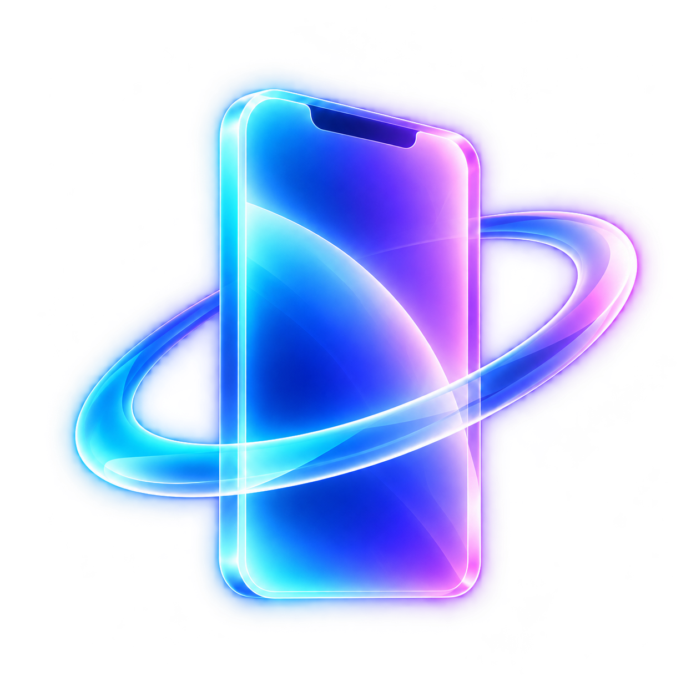
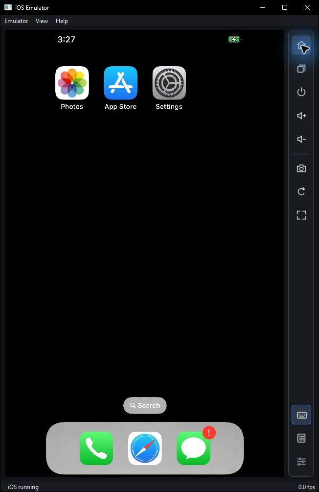
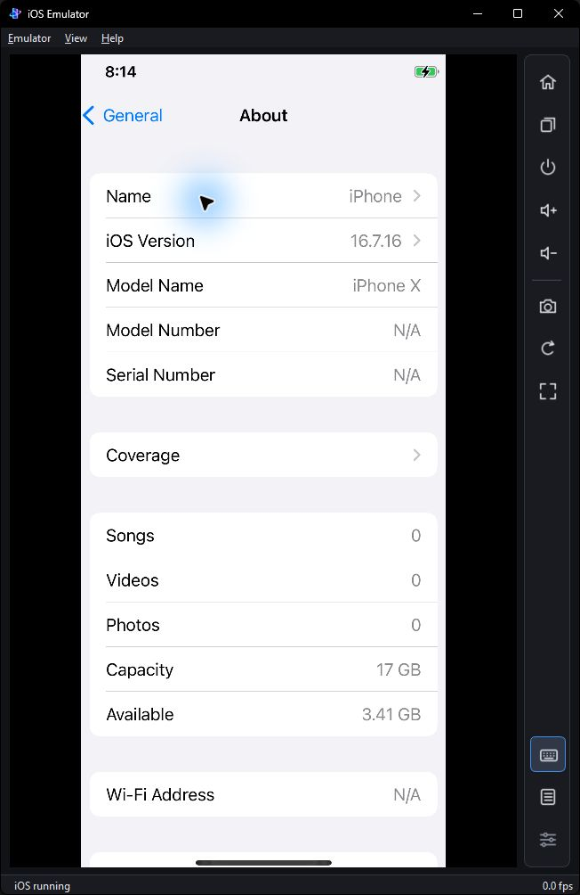
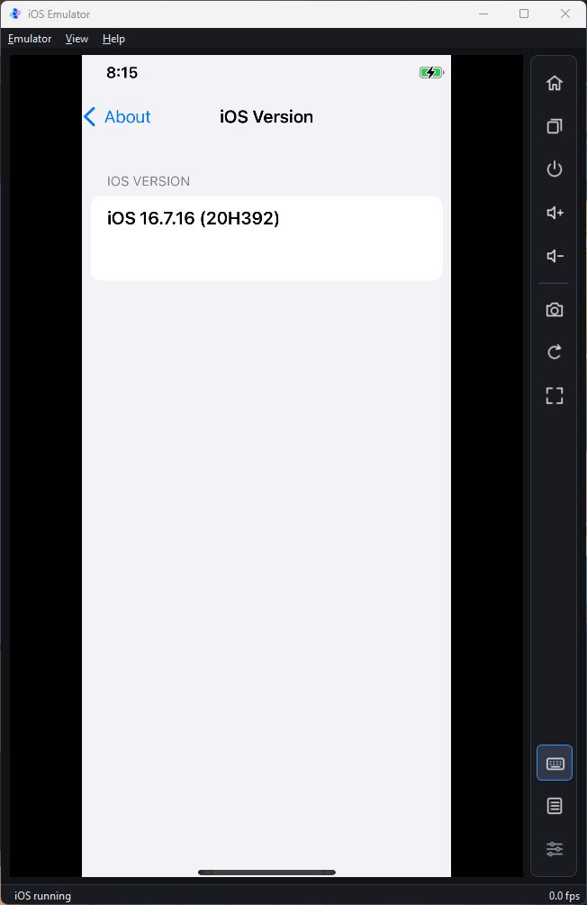
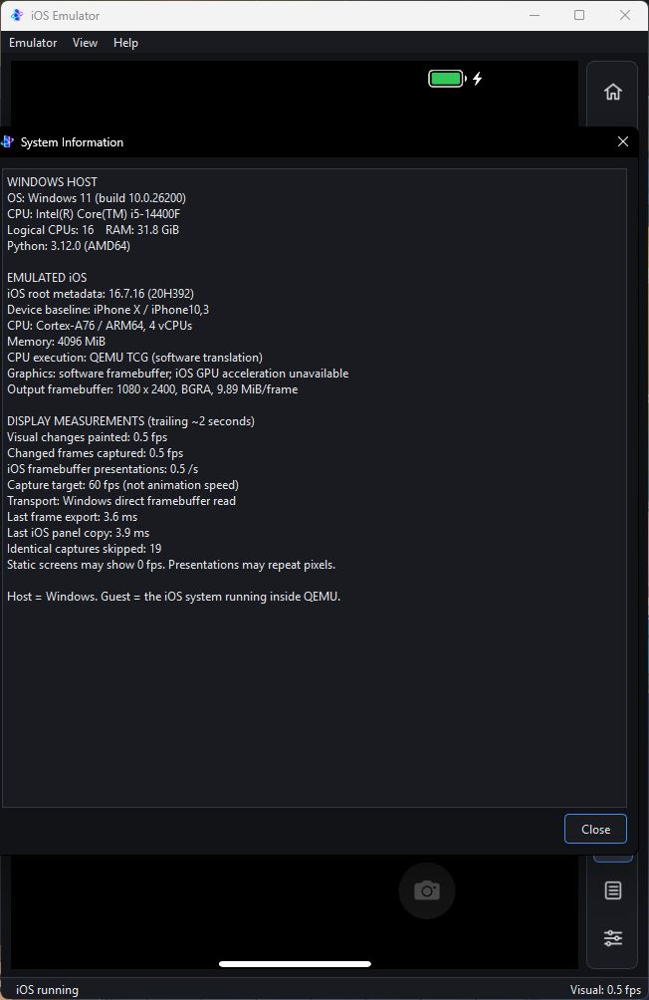
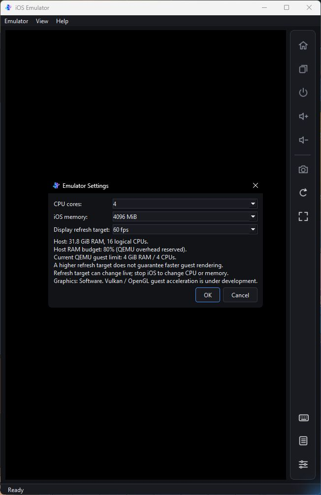

  

  <h1>iOSEmu</h1>

  
<strong>Experimental iOS Userland on QEMU</strong>

  

    Real iOS · Patched XNU · Windows Development
  

  

    An experimental educational and research project running real iOS userland on a patched open-source XNU kernel under QEMU.
  

> [!IMPORTANT]
> This independent project is not affiliated with, endorsed by, sponsored by, or developed in cooperation with Apple Inc. Apple, iPhone, and iOS are trademarks of Apple Inc. Apple firmware and filesystem images are downloaded separately and are not included in this repository. Third-party components retain their own licenses.

## Windows development

Active Windows development takes place on the [`dev/window-native`](https://github.com/MRHRTZ/ios-emulator/tree/dev/window-native) branch.

- [Windows setup guide](https://github.com/MRHRTZ/ios-emulator/blob/dev/window-native/docs/WINDOWS.md)
- [Windows development README](https://github.com/MRHRTZ/ios-emulator/blob/dev/window-native/README.md)
- [Development checklist](https://github.com/MRHRTZ/ios-emulator/blob/dev/window-native/docs/TODO.md)
- [Verified status](https://github.com/MRHRTZ/ios-emulator/blob/dev/window-native/docs/STATUS.md)

Real iOS 16.7.16 / iPhone X SpringBoard, touch input, host UTC, multicore boot, and network traffic have been observed under Windows QEMU. Safari can receive HTML, but page content remains blank.

GPU acceleration, application compatibility, responsiveness, native APFS preparation, and bundling remain unfinished. A high display refresh target does not guarantee a high guest frame rate.

**Branch policy**

| Branch | Purpose |
| --- | --- |
| `dev/window-native` | Active Windows development |
| `window-native` | Separate Windows release promotion |
| `main` | Stable cross-platform baseline |

Development features are not necessarily available on `main`.

## Windows development screenshots

Actual captures from `dev/window-native`. These development features are not released on `main`.

  <table>
    <tr>
      <td align="center" width="33%">
        
        Home screen
      </td>
      <td align="center" width="33%">
        
        About device
      </td>
      <td align="center" width="33%">
        
        iOS version
      </td>
    </tr>
  </table>

### System information

  

  
Host and guest system information

  

  
Native settings interface

### Test environment

- **Host OS:** Windows 11
- **CPU:** Intel Core i5-14400F
- **Host memory:** 31.8 GiB visible RAM
- **Emulated CPUs:** 4 ARM64 CPUs
- **Guest memory:** 4096 MiB
- **Guest OS:** iOS 16.7.16 (20H392)
- **Guest device:** iPhone X

Real iOS Settings identifies the guest as **iPhone X running iOS 16.7.16 (20H392)**.

A capture target is not an animation frame rate; the UI still has substantial performance limitations.

See [capture conditions](docs/SCREENSHOTS.md) and [performance evidence](docs/PERFORMANCE.md).

## Original phone port

The [original Redmi Note 10 Pro port documentation](docs/PHONE_PORT_REFERENCE.md) is preserved as a historical, hardware-specific reference.

Its phone installation instructions and performance figures do not describe the Windows emulator.
