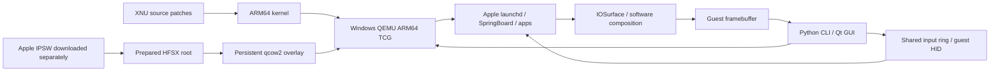

# How this port works

## Boot and display flow

The original ios-sweet work targeted a Qualcomm phone. The PC path adapts its
XNU platform services to QEMU's `virt` machine; it does not run an Xcode iOS
Simulator package or translate Swift source. Apple's separately obtained ARM64
userspace runs on the guest kernel. TCG translates ARM64 instructions on x64.

## Integrated systems

| System | Implementation | Current limit |
| --- | --- | --- |
| CPU / SMP | Cortex-A76 model, flat Aff0 MPIDRs, HVC PSCI, GICv3 / SGI | 1–8 exposed; 2/4 runtime verified, 5–8 experimental |
| Clock | QEMU PL031 host UTC RTC exposed in ADT | Pause/resume clock behavior still needs validation |
| Storage | Patched virtio-mmio block driver; HFSX root; qcow2 writes | Stop is a power cut; HFS journal replays next boot |
| Network | Patched virtio Ethernet en0; IOKit identity; BPF DHCP; QEMU user NAT | IPv6 remote traffic and IPv4 address/route verified; broader app tests pending |
| Graphics | Minimal IOSurface and IOMobileFramebuffer services; CoreAnimation CPU composition | No guest GPU; Safari content white |
| Input | Shared ring via loopback qtest; digitizer and consumer HID | Host USB HID keyboard service added in 0091; runtime validation pending |
| Host UI | Python / PySide6 native Windows controls, QMP lifecycle | Theme/UI state independent from iOS appearance |
| Isolation | Persistent overlay lock, loopback QMP/qtest ports, base image read-only backing | Full pipeline concurrency deferred |
| Preparation | Python firmware streaming/checksums, ADT tools, existing temporary Linux QEMU helper for HFS | Native Windows APFS pipeline deferred; no WSL/Docker |

Current guest memory validation covers up to 4 GiB. The UI derives an 80% host
RAM budget, reserves QEMU address-space overhead, then applies the guest cap.
CPU choices reserve host capacity and stop at the guest's eight-core limit.
Display refresh is a target, limited by screen refresh; it is not guest FPS.

## Why 5–7 FPS does not identify one bottleneck

CPU translation, guest software rasterization, framebuffer export (~10 MiB per
frame), memory copies and Qt scaling all contribute. More guest cores may add
TCG scheduling overhead. GPU presentation alone does not accelerate iOS Metal
or WebKit drawing. Measure frame-export cost and responsiveness before raising
the core count. The desktop worker now schedules frames against deadlines,
avoiding an extra full sleep interval after every export.

## Missing services and visible symptoms

The home screen's two large Waiting placeholders and black wallpaper are
recorded bring-up symptoms, not a deliberate shipped theme. Their backing
SpringBoard layout/extension/PosterBoard state is being inspected. Do not call
them installed app downloads without inspecting that state. A static wallpaper
asset can be provided, but it must be installed through a working guest path;
drawing an image over the host framebuffer would conceal the guest issue.
